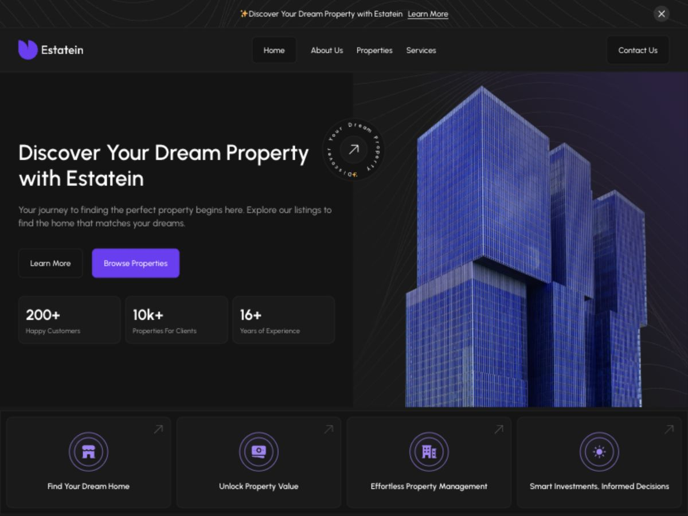

# Estatein - WordPress developer assessment

A custom WordPress theme implementing all six Estatein page types from Produce UI's Figma design for the Growmodo assessment. Built with PHP, CSS, and vanilla JavaScript, without a page builder or frontend framework.



## Deliverable status

- Six page types: Home, About Us, Properties, Property Details, Services, and Contact. Shared header/footer, searchable catalog, individual property URLs, service sections, offices, gallery, and enquiry forms.
- Editable page fields, property/testimonial/FAQ/team/client records, reusable PHP templates, responsive layouts, accessible native dialogs, mobile navigation, and private enquiry/subscriber storage.
- ACF Free is supported; native fields remain available without it. No ACF Pro dependency.
- **Public WordPress deployment is pending the owner's hosting purchase. Local preview does not satisfy the brief's live-demo requirement.**
- Scope expanded beyond the initial four-hour homepage plan. Additional pages use owner screenshots and the supplied reference site; full original-Figma pixel parity is not claimed. Social links open the named platforms. Office/team records are demonstration content.

## Install on WordPress hosting

1. Use a maintained PHP release with current security patches and MySQL/MariaDB. Review [deployment/security.md](deployment/security.md), including the October 2026 PHP advisories.
2. Upload `deliverables/estatein-theme.zip` using **Appearance -> Themes -> Add New -> Upload Theme**, then activate Estatein.
3. Optionally install **Advanced Custom Fields (Free)** from the official WordPress plugin directory.
4. Open **Appearance -> Estatein setup -> Import Estatein demo**. The importer creates Home, About Us, Properties, Services, Contact, and sample records. Property Details is generated for each published property. Set **Settings -> Permalinks** to **Post name** and save once. If a front page already exists, select the imported Home under **Settings -> Reading** yourself; the importer preserves the previous selection.
5. Edit **Pages -> Home** for headings, statistics, service labels, hero image, and contact email. Main editor content renders after the hero. Edit inner pages for their headings, service/office content, and gallery. Edit Properties, Testimonials, FAQs, Team, and Clients from their dashboard menus. Property main content renders on the detail page; extra image fields enable photo thumbnails.
6. Add real contact details, configure your privacy information and social destinations for a real business, and use test email addresses during assessment review. Subscribers and Enquiries are separate administrator-only menus; deletion is supported. Enquiries retain contact details, message, property reference, and optional preferences.
7. Enable HTTPS, check the public URL while logged out, and repeat the live checks in [deployment/README.md](deployment/README.md).

The theme ZIP contains ready-to-run assets. Node, npm, SQLite, WP-CLI, and the local testing tools are **not** needed on the hosting server. Subscriber/enquiry data remains in the site's database when changing themes; no destructive uninstall runs automatically.

## Local development

Requires Node.js and a patched PHP CLI with PDO SQLite, mbstring, GD, XML, cURL, and Zip extensions. The setup script downloads official WordPress, ACF Free, the WordPress SQLite integration, and WP-CLI into ignored `.runtime/`.

```sh
npm ci --ignore-scripts
npm run build
export ESTATEIN_PHP=/path/to/php
npm run setup:local
"$ESTATEIN_PHP" -c .runtime/php.ini -S 127.0.0.1:8888 -t .runtime/wordpress scripts/local-router.php
```

On this Mac, PHP is at `/opt/homebrew/opt/php@8.3/bin/php`. Local credentials are randomly generated in `.runtime/local-access.json`, with file mode 0600. Never publish `.runtime/`, local database files, or these credentials. SQLite is only the local testing fixture; production instructions use MySQL/MariaDB.

```sh
npm run test:http
node tests/full-site-http.mjs
node tests/inquiries-http.mjs
"$ESTATEIN_PHP" .runtime/wp-cli.phar --path=.runtime/wordpress eval-file tests/content.php
"$ESTATEIN_PHP" .runtime/wp-cli.phar --path=.runtime/wordpress eval-file tests/full-site-content.php
"$ESTATEIN_PHP" .runtime/wp-cli.phar --path=.runtime/wordpress eval-file tests/catalog.php
"$ESTATEIN_PHP" .runtime/wp-cli.phar --path=.runtime/wordpress eval-file tests/inquiries.php
```

The tests use and clean up explicitly named local test records. Do not run them against production. `tests/http.mjs` refuses non-local URLs.

## Code layout and decisions

- `theme/estatein/`: installable theme. `inc/` holds content queries, ACF/native field definitions, setup/import, catalog routing, inner-page fields, and private form handlers. `template-parts/` holds reusable cards.
- `assets/css/{main,pages}.css` and `assets/js/{main,pages}.js`: readable sources. `npm run build` creates their minified production counterparts; PHP enqueues the minified files with versioning and deferred JavaScript.
- `scripts/`: asset preparation, local fixture setup, and production asset build. Figma assets are already included; `download-assets.mjs` is only useful with retained design-context responses in ignored `.references/`.
- `tests/`: HTTP behavior/security checks and WordPress content/permission checks.
- `docs/`: development report and verification notes. `deployment/`: hosting handoff and security configuration examples.

The public subscription endpoint only stores a mailing-list record; it does not promise email delivery or send to external services. Duplicate subscriptions receive the same success response, preventing address enumeration. Per-IP throttling is basic abuse deterrence, not a replacement for hosting request limits or a WAF.

## Design and attribution

Design: [Estatein real estate template by Produce UI](https://www.figma.com/community/file/1314076616839640516). Homepage images, icons, and artwork were downloaded from the supplied Figma document and bundled locally. Additional pages use owner-provided screenshots and [the owner-supplied reference site](https://estatein-seven.vercel.app/). With permission, temporary gallery/team photos and icons were cropped from screenshots. The About hero is from that reference site. Replace temporary crops with original exports for a real production business; original asset rights remain with their owners. Urbanist is self-hosted; its SIL Open Font License is included in `assets/fonts/OFL.txt`. Theme code is GPL-2.0-or-later; original design assets retain their respective licenses.

AI assisted code drafting and design inspection. The implementation was adapted to WordPress and checked through actual browser use and local integration tests. See [verification notes](docs/VERIFICATION.md) for tested behavior and explicit limits.
